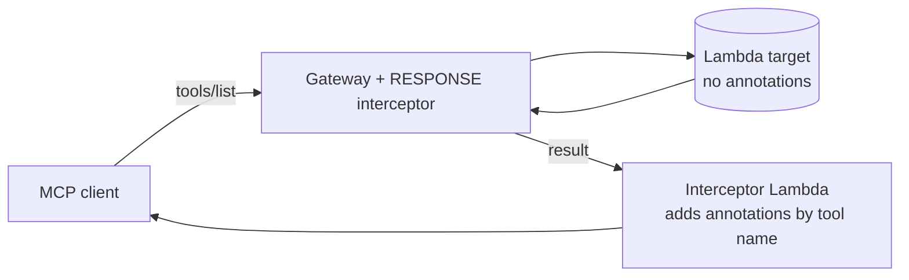

# MCP tool annotations on an AgentCore Gateway Lambda target

A runnable answer to [this re:Post question](https://repost.aws/questions/QUjSuIjTBBQPKw4HFu7P8kng):
an AgentCore Gateway with Lambda targets cannot carry MCP tool annotations, and the asker needs them
(for example `readOnlyHint`) to publish the server to a marketplace. This repo tests one way around it,
a Gateway RESPONSE interceptor that adds annotations to `tools/list`, and records what happens when the
interceptor fails. Everything runs against a mock target.

## What it shows

| # | Question | Result (tested) |
|---|----------|-----------------|
| A1 | Can the target's tool definition carry `annotations`? | No. The API model accepts only `name`, `description`, `inputSchema`, `outputSchema` |
| A2 | What does a plain Gateway return from `tools/list`? | Both tools, no annotations |
| A3 | What does a Gateway with a RESPONSE interceptor return? | The same tools, with `annotations` added by the interceptor |
| A4 | Do `tools/call` requests still work through the interceptor? | Yes |
| A5 | What happens if the interceptor fails? | **Every call on that Gateway fails, not just `tools/list`** (HTTP 500) |

A5 is the part to read before you copy this. The interceptor sits on the response path of the whole
Gateway. When I made it raise, and separately made it return a malformed payload, `tools/list` and
`tools/call` both failed with HTTP 500 while an identical Gateway without the interceptor kept working.
So the interceptor is now a hard dependency of every call. Keep it tiny, test it, and alarm on it.

## How it works

The interceptor ([lambda/annotate.py](lambda/annotate.py)) looks at the request method. For `tools/list` it adds
an `annotations` object to each tool, keyed by the tool name with the target prefix removed (the Gateway lists
tools as `<target>___<tool>`). For everything else it returns the response unchanged. The annotation map is one
dictionary in that file.

## Read this before you rely on annotations

- The MCP specification says clients "MUST consider tool annotations to be untrusted unless they come from
  trusted servers", and the schema says clients "should never make tool use decisions based on ToolAnnotations
  received from untrusted servers" ([spec](https://modelcontextprotocol.io/specification/2025-06-18/server/tools),
  [schema](https://github.com/modelcontextprotocol/modelcontextprotocol/blob/main/schema/2025-06-18/schema.ts)).
  They are hints for a client's UI and approval flow. They are not an authorisation control. If a tool must be
  blocked for some users, do that at the Gateway with a policy, not with `readOnlyHint`.
- Omitting a hint is not neutral. The schema defaults are `destructiveHint: true` and `openWorldHint: true`, and
  `destructiveHint` is only meaningful when `readOnlyHint` is false. A tool with no annotations can look more
  dangerous to a client than one that declares them.
- Be accurate. A wrong `readOnlyHint: true` on a tool that writes is worse than none.

## What I did not test or verify

- Whether any particular marketplace accepts a server fronted this way. The asker says one requires annotations;
  I have not checked that requirement.
- Whether AWS plans native support for annotations on Lambda targets. Nothing here speaks to a roadmap.
- Streaming responses, large tool lists and pagination (the interceptor only touches the tools in one page).
- Other target types (MCP server, OpenAPI). This uses a Lambda target, as in the question.
- The intercepted path's latency or cost.

## Run it

Needs an AWS account with CDK bootstrapped in us-east-1, Node 20+, Python 3.10+ with boto3.

    make deploy    # about 1 to 2 minutes
    make demo      # prints PASS/FAIL for A1 to A4, records A5 (transcript in docs/transcript.txt)
    make destroy

The demo user and password are throwaway and live only in the demo user pool. The demo flips the interceptor's
`MODE` environment variable to observe failures and restores it afterwards.

## Cost

Gateway invocations are listed at $5 per million ([pricing](https://aws.amazon.com/bedrock/agentcore/pricing/)).
One demo run makes under 30 Gateway calls, so the AgentCore side is well under a cent. Lambda, Cognito and the
interceptor invocations around it are not priced here. This is an estimate from list prices, not a measured bill.
